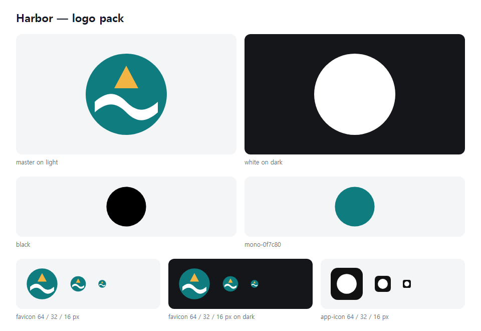
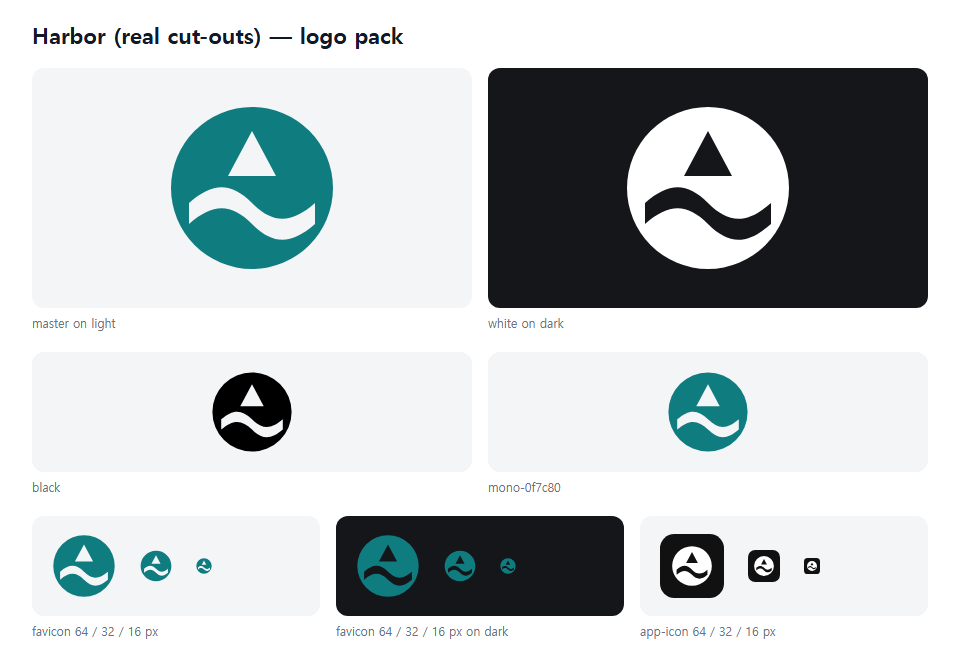
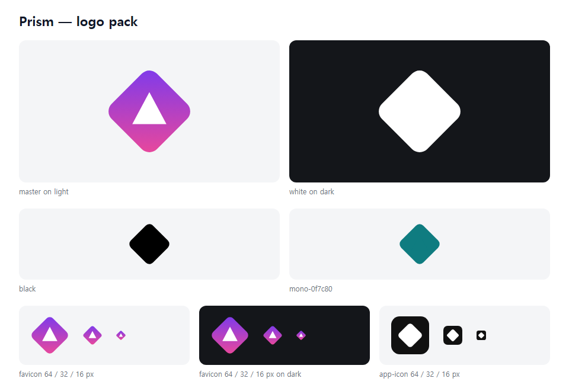
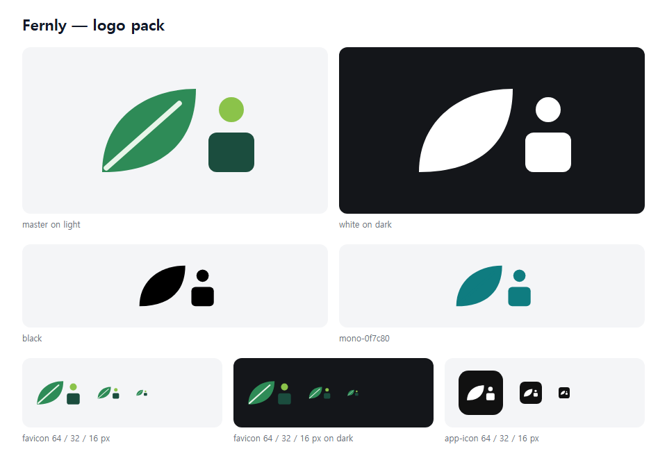

<div align="center">

# logo-pack

**Turn one logo SVG into every file you ship (black, white, brand colour, favicon, app icon) plus a one-page sheet that shows what breaks.**

Logo skills for Claude Code stop at the master file. [logo-design-skill](https://github.com/kaankiziltug/logo-design-skill) exports the variants and [brand-identity-skill](https://github.com/fatihaydost/brand-identity-skill) puts them on a contact sheet. logo-pack does both in one standard-library Python file.

Works with **Claude Code** and **Codex**.

 



<sub>Real output of the Quick start command for <code>examples/harbor.svg</code>. The sheet shows the problem at once: the white wave is painted on top of the circle, so every one-colour version turns into a plain disc.</sub>

</div>

## Quick start
```bash
git clone https://github.com/Dodai0419/logo-pack && cd logo-pack
python logo_pack.py examples/harbor.svg --mono "#0F7C80" --title "Harbor" --out-dir dist
```
```
note: master contains white paint — check the one-colour files for blobs (fake cut-outs).
wrote dist/harbor-black.svg
wrote dist/harbor-white.svg
wrote dist/harbor-mono-0f7c80.svg
wrote dist/harbor-square.svg
wrote dist/harbor-favicon.svg
wrote dist/harbor-app-icon.svg
wrote dist/harbor-sheet.svg
```
Python 3.8+. No `pip install`. Open `dist/harbor-sheet.svg` in any browser.

## Gallery
Every sheet below is unedited output of `logo_pack.py` on a file in `examples/` (all logos are original, made for this repo).

### Fixing what the sheet caught
`examples/harbor-cutout.svg` draws the wave and the sail as real holes (`fill-rule="evenodd"`) instead of white paint. Now every one-colour version, the favicon and the app icon read correctly:



### Gradient mark: Prism
`python logo_pack.py examples/prism.svg --mono "#0F7C80" --title "Prism" --out-dir docs/prism`

A rotated gradient tile with a white triangle. The sheet shows the triangle vanishing in every one-colour version: it needs to be a cut-out too.



### Wide lockup: Fernly
`python logo_pack.py examples/fernly.svg --mono "#0F7C80" --title "Fernly" --out-dir docs/fernly`

A 200×120 mark: the square favicon and app icon are centred on the artwork's real bounding box, not on its viewBox.



The SVG sheets themselves are in `docs/<name>/<name>-sheet.svg`, next to all variants.

## What you get
| File | Use |
|------|-----|
| `<name>-black.svg` | one colour, black (print, stamps, fax-quality places) |
| `<name>-white.svg` | one colour, white, for dark backgrounds |
| `<name>-mono-<hex>.svg` | one colour in your brand colour (repeat `--mono`) |
| `<name>-square.svg` | mark centred on a 256×256 canvas (avatars, social) |
| `<name>-favicon.svg` | tight square for browser tabs (works as `favicon.svg`) |
| `<name>-app-icon.svg` | mark on a rounded tile (`--icon-bg`, `--icon-fg`, `--icon-scale`) |
| `<name>-sheet.svg` | the contact sheet: master on light and dark, one-colour versions, favicon and app icon at 64/32/16 px |

Other flags, same as upstream: `--name`, `--title`, `--keep-white`, `--favicon-source <simpler.svg>`, `--optical-offset`, `--only black white ...`. Add `--no-sheet` to skip the sheet.

## The problem
- A logo that looks fine large can fall apart in one colour or at 16 px, and you only find out after shipping the favicon.
- logo-design-skill writes the variants but you have to open six files to check them; its PNG and web-icon export needs cairosvg, rsvg, Inkscape or Chrome.
- brand-identity-skill's contact sheet is the right check, but it is built inside a 20,000-line pipeline with fonts, HarfBuzz and a set folder layout, so you cannot point it at one SVG.

## The solution
| Idea | Fixes |
|------|-------|
| **Same variants, same bytes** | The six SVG variants are byte-identical to logo-design-skill's `export_variants.py` (checked on 1,432 SVGs, see Benchmarks) |
| **One sheet per logo** | brand-identity-skill's check (primary large, one colour on light and dark, small sizes) for any single SVG |
| **Real sizes** | The favicon and app icon are drawn at 64, 32 and 16 px, where most marks actually fail |
| **Measure once** | The artwork's bounding box is computed once and reused for square, favicon and app icon (upstream recomputes it three times) |
| **One file, no dependencies** | 534 lines of standard-library Python instead of 832 lines across two modules |

## Use with Claude Code
```bash
/plugin marketplace add Dodai0419/logo-pack
/plugin install logo-pack@logo-pack
```
Then ask: *"Make the delivery files for logo.svg and show me the sheet."* The skill tells the agent to run logo-pack, look at the sheet, and fix fake cut-outs before calling the logo done.

## Use with Codex (ChatGPT)
```bash
git clone https://github.com/Dodai0419/logo-pack && cp -r logo-pack/skills/* ~/.codex/skills/
```
Or copy `AGENTS.md` to your project root.

## Benchmarks
Windows 11, Python 3.11.1. Upstream is [kaankiziltug/logo-design-skill@7340903](https://github.com/kaankiziltug/logo-design-skill/tree/734090317a2155c5bf1ae8bd4cc85c6848a0128f).

| | logo-design-skill `export_variants.py` | logo-pack |
|-|-|-|
| SVG variants, 3 example logos × 6 variants | reference | 18/18 byte-identical (in `tests/`) |
| SVG variants, all 1,432 SVGs in logo-design-skill's reference library × 6 variants + the white-paint note | reference | 1,432/1,432 identical, 0 errors |
| time for that 1,432-file run, in process | 92.3 s | 39.0 s |
| one CLI run (`--mono`), median of 10, 3 examples | 391–402 ms | 310–340 ms (also writes the sheet) |
| lines of code | 832 (`export_variants.py` 233 + `svglib.py` 599) | 534 (variants + geometry + sheet) |
| contact sheet | none | yes |
| PNG / favicon.ico / web manifest export | yes, needs a render backend | not included (see Roadmap) |
| dependencies | none for SVG; a render backend for PNG | none |

The library run imports both modules and calls the same functions on each file with `--mono "#0F7C80" --title "T"`; the comparison harness and the trademarked library files are not part of this repo.

## Inspired by
- [kaankiziltug/logo-design-skill](https://github.com/kaankiziltug/logo-design-skill) — the variant exporter, the SVG geometry code and the white-paint warning (MIT, code reused).
- [fatihaydost/brand-identity-skill](https://github.com/fatihaydost/brand-identity-skill) — the contact sheet idea: primary large, one colour on light and dark, and the mark at 32 and 16 px, because "a broken mark can pass every automated check: look at it" (idea only; no code copied).

## Roadmap
- [ ] PNG, `favicon.ico` and web-manifest export through a local headless browser
- [ ] Mark the sheet red when a one-colour version loses more than half of its shapes
- [ ] Optional brand-colour background row on the sheet

## License
MIT. Variant and geometry code adapted from logo-design-skill (MIT, Copyright (c) 2026 kaankiziltug); see `LICENSE`.
